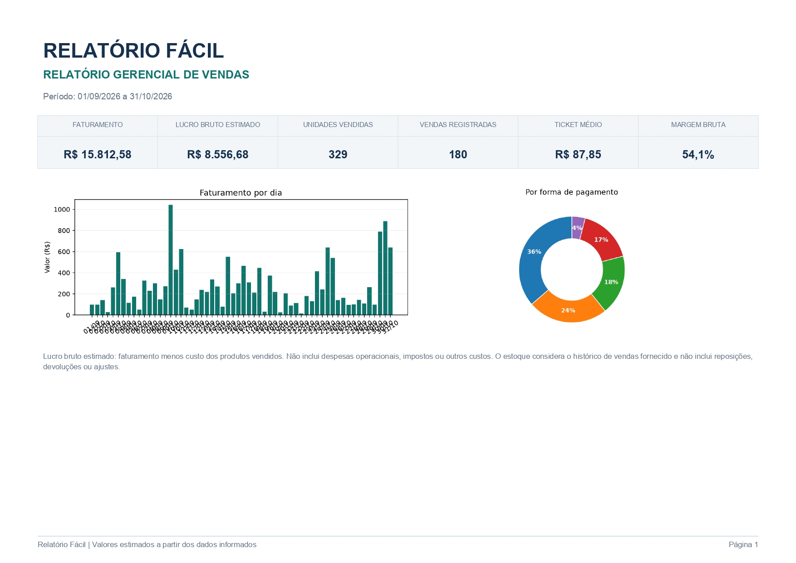
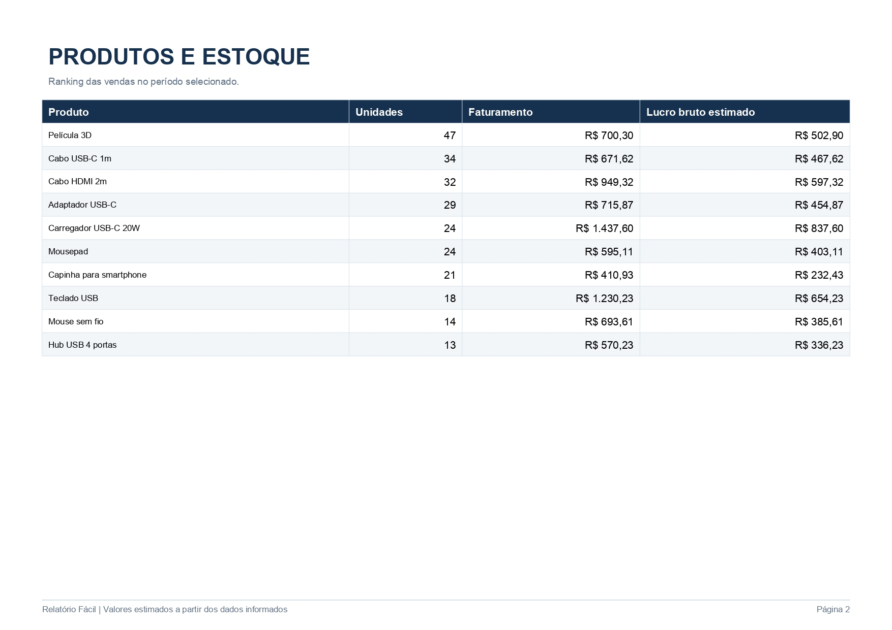
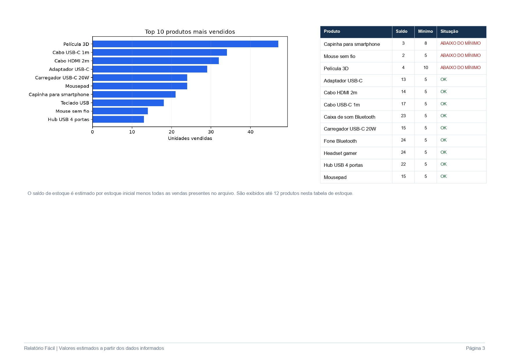

# Relatório Fácil

### Automação de relatórios comerciais com Excel, VBA e Python

Projeto pessoal de desenvolvimento de uma solução integrada para organizar dados comerciais, automatizar processos, validar informações e gerar relatórios gerenciais em PDF.

O objetivo é demonstrar como a integração entre ferramentas de produtividade e programação pode ajudar a reduzir tarefas repetitivas, melhorar a consistência dos dados e transformar registros comerciais em informações úteis para análise.

## Demonstração

O sistema gera relatórios gerenciais com indicadores financeiros, gráficos, ranking de produtos e informações sobre estoque.

### 1. Relatório gerencial

### 2. Ranking de produtos

### 3. Controle de estoque

*As demonstrações utilizam exclusivamente dados fictícios.*

## Contexto e problema

A organização de dados comerciais e a elaboração de relatórios podem envolver tarefas repetitivas, conferências manuais e informações inconsistentes.

Pequenos comércios precisam acompanhar produtos, vendas, faturamento e estoque, mas nem sempre dispõem de ferramentas simples e acessíveis para consolidar essas informações.

O Relatório Fácil foi desenvolvido com a proposta de simplificar parte desse processo, integrando uma interface em Excel a um programa escrito em Python.

## Solução e arquitetura

A solução utiliza três componentes principais:

- **Microsoft Excel:** interface para cadastro de produtos, registro de vendas e consulta de indicadores.
- **VBA:** automação dos formulários, execução de rotinas e validação das operações.
- **Python:** processamento dos dados, cálculo de indicadores, criação de gráficos e geração dos relatórios em PDF.

### Fluxo de funcionamento

1. O usuário cadastra produtos e registra vendas na planilha.
2. As macros VBA executam as validações e automatizam as operações.
3. O Excel aciona o programa Python.
4. O Python processa os dados comerciais.
5. O sistema gera um relatório gerencial em PDF.

## Funcionalidades implementadas

- Cadastro de produtos com identificação por SKU.
- Registro de vendas e formas de pagamento.
- Validação de SKUs duplicados e produtos inexistentes.
- Verificação de disponibilidade de estoque.
- Validação de quantidades e descontos.
- Cálculo de faturamento e custo dos produtos vendidos.
- Estimativa de lucro bruto e margem bruta.
- Cálculo de unidades vendidas e ticket médio.
- Ranking de produtos mais vendidos.
- Identificação de produtos abaixo do estoque mínimo.
- Processamento de arquivos comerciais em Excel e CSV pelo motor Python.
- Geração automatizada de relatórios em PDF.
- Apresentação de indicadores em tabelas e gráficos.

## Demonstração com dados fictícios

Para validar o funcionamento da solução, foi criada uma base demonstrativa com 180 registros de vendas fictícias, abrangendo setembro e outubro de 2026.

No relatório consolidado da demonstração, foram apresentados os seguintes resultados:

| Indicador | Resultado |
|---|---:|
| Faturamento | R$ 15.812,58 |
| Lucro bruto estimado | R$ 8.556,68 |
| Unidades vendidas | 329 |
| Vendas registradas | 180 |
| Ticket médio | R$ 87,85 |
| Margem bruta estimada | 54,1% |

Esses dados permitem demonstrar o processamento de um volume maior de registros, a consolidação de indicadores e a geração de relatórios com informações de produtos e estoque.

Os valores são fictícios e utilizados exclusivamente para demonstração e testes.

## Testes e validação

Durante o desenvolvimento, foram realizados testes de funcionalidades, processamento de dados e integração entre Excel, VBA e Python.

Entre as situações verificadas estão:

- Cadastro e registro de produtos.
- Registro de vendas.
- Bloqueio de SKU duplicado.
- Identificação de produtos inexistentes.
- Bloqueio de vendas com estoque insuficiente.
- Validação de descontos.
- Conferência dos cálculos financeiros.
- Consolidação de vendas por forma de pagamento.
- Atualização do ranking de produtos.
- Geração de relatórios em PDF.

Os testes foram realizados com dados fictícios e cenários controlados.

## Tecnologias utilizadas

- Microsoft Excel
- VBA (Visual Basic for Applications)
- Python
- Pandas
- OpenPyXL
- Matplotlib
- ReportLab

## Aprendizados

O desenvolvimento do Relatório Fácil proporcionou experiência prática em:

- Integração entre diferentes ferramentas.
- Automação de processos com Python e VBA.
- Processamento e validação de dados.
- Cálculo e organização de indicadores comerciais.
- Criação de gráficos e relatórios automatizados.
- Testes de funcionalidades e integração.
- Tratamento de erros.
- Documentação e organização de projetos de software.
- Desenvolvimento iterativo e melhoria contínua.

## Limitações conhecidas

Os indicadores de lucro apresentados representam estimativas de lucro bruto, calculadas pela diferença entre faturamento e custo dos produtos vendidos. Não incluem automaticamente despesas operacionais, impostos, taxas ou outros custos.

O controle de estoque da versão atual considera o estoque inicial menos as quantidades vendidas. Reposições, devoluções e ajustes ainda não são contemplados integralmente.

O sistema não substitui ferramentas fiscais ou contábeis.

## Status do desenvolvimento

**Projeto pessoal em desenvolvimento contínuo.**

A versão atual já possui integração entre Excel, VBA e Python, com cadastro de produtos, registro de vendas, validação de dados, indicadores comerciais e geração automatizada de relatórios em PDF.

Foram realizados testes com uma base demonstrativa de 180 registros de vendas fictícias, abrangendo setembro e outubro de 2026.

O projeto continua recebendo melhorias, especialmente na apresentação visual dos relatórios, nos gráficos, nas validações, na documentação e na experiência de utilização.

**Observação:** os dados apresentados nas demonstrações são inteiramente fictícios e utilizados exclusivamente para fins de teste e apresentação do projeto.

## Sobre este repositório

Este repositório disponibiliza a documentação, os códigos-fonte utilizados na demonstração, arquivos de dados fictícios e exemplos dos relatórios gerados.

O pacote comercial completo, incluindo os arquivos de distribuição e a versão comercial da planilha, não está disponibilizado publicamente.

## Como testar a demonstração

1. Acesse a pasta `demo` deste repositório.
2. Baixe o arquivo `RelatorioFacil_DadosFicticios_Portifolio.xlsm`.
3. Abra o arquivo no Microsoft Excel desktop.
4. Consulte as abas de cadastro, vendas e dashboard.
5. Confira os relatórios gerados com os dados fictícios.

**Requisitos:** Microsoft Excel desktop para Windows com suporte a macros VBA. A geração de relatórios também utiliza o programa auxiliar Python, conforme a configuração da demonstração.

---

**Desenvolvido por Caio Amano**

[GitHub](https://github.com/caioamano) · [LinkedIn](https://www.linkedin.com/in/caio-henrique-amano/)
