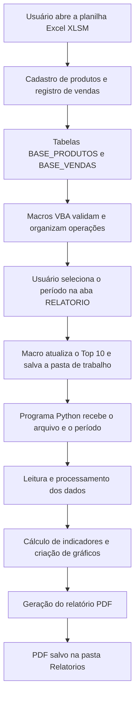

# Arquitetura do Relatório Fácil

## 1. Visão geral

O Relatório Fácil é um projeto de automação de relatórios comerciais que integra Microsoft Excel, VBA e Python. A planilha funciona como interface de operação e armazenamento dos registros; as macros VBA automatizam ações do usuário e acionam o programa Python; o motor Python processa os dados e produz relatórios em PDF.

O projeto foi pensado para pequenos comércios que precisam registrar produtos e vendas, acompanhar indicadores e consultar informações de estoque.

## 2. Componentes da solução

### Microsoft Excel (`.xlsm`)

A pasta de trabalho habilitada para macros concentra a interface e as tabelas utilizadas pelo sistema. As principais abas são:

- `INICIO`: tela inicial e navegação.
- `CADASTRO_PRODUTO`: formulário de cadastro de produtos.
- `LANCAR_VENDA`: formulário de registro de vendas.
- `BASE_PRODUTOS`: tabela de produtos (`tbProdutos`).
- `BASE_VENDAS`: histórico de vendas (`tbVendas`).
- `DASHBOARD`: indicadores e gráficos.
- `RELATORIO`: seleção do período e apresentação do resumo utilizado no relatório.

### VBA

As macros automatizam operações na pasta de trabalho. Entre as rotinas implementadas estão:

- `CadastrarProduto`: valida os campos e registra um produto na tabela de produtos.
- `RegistrarVenda`: valida a venda, verifica o SKU e o estoque disponível e registra a operação.
- `AtualizarTop10Periodo`: consolida as vendas do período selecionado por produto e atualiza o ranking.
- `GerarRelatorioPython`: atualiza o ranking, salva a pasta de trabalho e chama o programa Python para gerar o PDF.

### Python

O motor está organizado no arquivo `RelatorioFacil_Sistema.py`. Ele recebe os dados comerciais, realiza o processamento necessário, calcula indicadores, constrói gráficos e gera o relatório em PDF.

O projeto utiliza bibliotecas Python para diferentes responsabilidades:

- **Pandas:** processamento e consolidação de dados.
- **OpenPyXL:** leitura de arquivos Excel.
- **Matplotlib:** criação de gráficos.
- **ReportLab:** composição e geração dos documentos PDF.

A implementação também utiliza bibliotecas auxiliares da própria linguagem e do ecossistema Python.

## 3. Fluxo de execução

## 4. Entradas e saídas

### Entrada principal pelo Excel

A pasta de trabalho contém as tabelas `tbProdutos` e `tbVendas`. A macro de geração de relatório informa ao programa Python o caminho do arquivo Excel, a data inicial, a data final e o caminho de saída do PDF.

### Entradas aceitas pelo motor Python

A implementação do motor também contempla processamento por meio de:

- Um arquivo Excel contendo as abas `BASE_PRODUTOS` e `BASE_VENDAS`.
- Dois arquivos CSV separados: um com os produtos e outro com as vendas, seguindo a estrutura de colunas esperada pelo programa.

Essa capacidade do motor Python não significa, por si só, que exista um botão de importação de CSV na interface do Excel.

### Saída

O resultado principal é um relatório PDF com indicadores do período, gráficos, ranking de produtos e informações de estoque. Na integração atual, o arquivo é direcionado para a pasta `Relatorios`, junto aos arquivos do sistema.

## 5. Indicadores e regras de negócio

Entre os indicadores calculados ou apresentados estão:

- Faturamento: soma dos totais das vendas consideradas no período.
- Custo dos produtos vendidos: quantidade vendida multiplicada pelo custo unitário registrado.
- Lucro bruto estimado: faturamento menos o custo dos produtos vendidos.
- Margem bruta estimada: lucro bruto estimado dividido pelo faturamento, quando o faturamento é positivo.
- Unidades vendidas e quantidade de registros de venda.
- Ticket médio, calculado pelo faturamento dividido pela quantidade de registros de venda.
- Faturamento por forma de pagamento.
- Ranking de produtos por quantidade vendida e faturamento.
- Saldo estimado de estoque.

O lucro apresentado é bruto estimado e não representa lucro líquido. Não são deduzidos automaticamente todos os impostos, taxas, despesas operacionais, perdas ou outros custos.

## 6. Limitações conhecidas

- O saldo de estoque da versão atual é estimado por `estoque inicial - quantidade vendida`.
- Reposições, devoluções e ajustes manuais de estoque ainda não são contemplados integralmente pelo fluxo atual.
- A importação de arquivos externos depende de que eles respeitem a estrutura de colunas esperada pelo motor Python.
- Os resultados dependem da consistência dos dados cadastrados.
- O sistema não substitui um sistema fiscal, contábil ou de gestão empresarial completo.

## 7. Ambiente e execução

A interface com macros foi desenvolvida para o Microsoft Excel desktop no Windows. A geração de PDF utiliza o programa auxiliar Python distribuído junto ao pacote de desenvolvimento. A execução de macros não é suportada no Excel para a Web nem no Google Planilhas.

## 8. Escopo deste repositório

Este documento descreve a arquitetura do projeto para fins de portfólio. Os arquivos de demonstração utilizam dados fictícios. A estrutura e as funcionalidades podem evoluir conforme novos testes e melhorias forem implementados.
